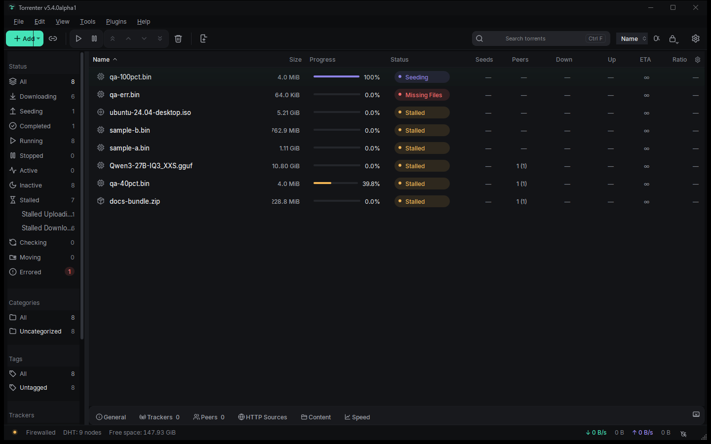
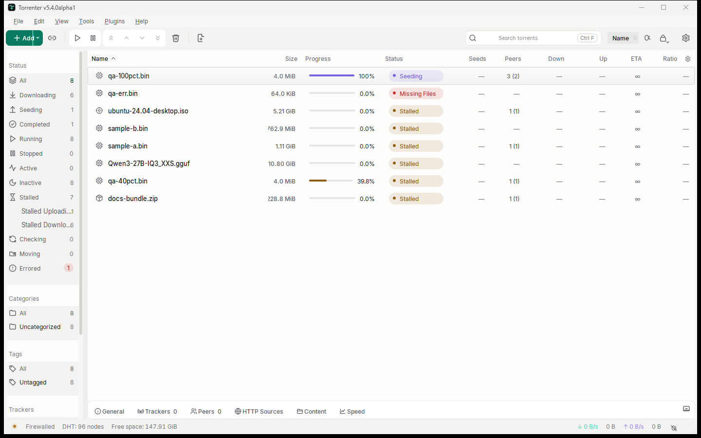

# Torrenter

A modern, dark-first BitTorrent client built on qBittorrent.

## Screenshots

**Dark**

**Light**

## Features

- Redesigned main window
- Details panel with speed graph
- New Add torrent and Settings dialogs
- Dark and light themes
- Compact window for smaller screens

## Building

Refer to the [INSTALL](INSTALL) file for compilation and installation instructions.

## Credits

Torrenter is based on [qBittorrent](https://github.com/qbittorrent/qBittorrent).

This project remains licensed under the [GNU General Public License v2.0 or later](COPYING) (GPL-2.0-or-later), unchanged from upstream.

Additional fonts and icons used in the interface:

- [Inter](https://rsms.me/inter/) — SIL Open Font License 1.1
- [Lucide](https://lucide.dev/) — ISC License
